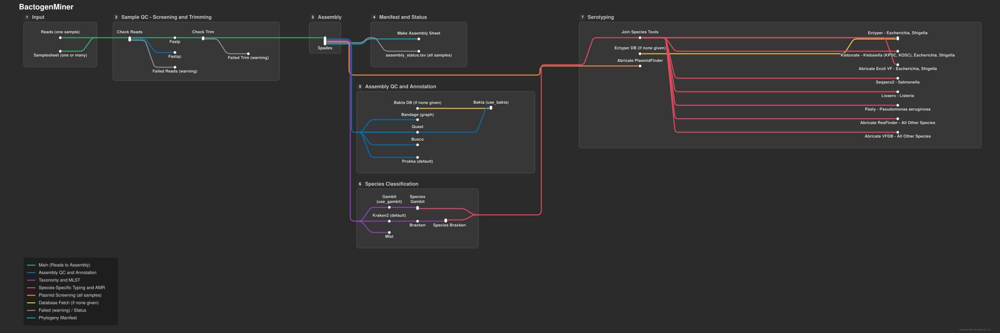

# BactogenMiner

[](https://www.nextflow.io/)
[](https://www.nextflow.io/)
[](https://www.docker.com/)
[](https://docs.conda.io/)
[](https://www.gnu.org/licenses/gpl-3.0)

**BactogenMiner** is an end-to-end, reproducible Nextflow (DSL2) workflow engineered for high-throughput bacterial whole-genome sequencing (WGS) data analysis. Designed for Illumina paired-end and single-end short reads, BactogenMiner integrates pre-assembly quality screening, read trimming, *de novo* genome assembly, multifaceted assembly quality control, genome annotation, taxonomic identification, intelligent dynamic species-specific typing/serotyping, antimicrobial resistance (AMR) and virulence factor profiling, and automated phylogeny-ready manifest compilation.

---

## Table of Contents

- [Overview & Key Features](#overview--key-features)
- [Pipeline Architecture](#pipeline-architecture)
- [Workflow Steps in Detail](#workflow-steps-in-detail)
- [Species-Specific Profiling & Dynamic Routing](#species-specific-profiling--dynamic-routing)
- [Prerequisites & Dependencies](#prerequisites--dependencies)
- [Reference Databases](#reference-databases)
- [Tool & Container Environment](#tool--container-environment)
- [Installation](#installation)
- [Quick Start & Usage](#quick-start--usage)
  - [1. Single-Sample Mode](#1-single-sample-mode)
  - [2. Multi-Sample Batch Mode (Samplesheet)](#2-multi-sample-batch-mode-samplesheet)
  - [3. Execution Profiles](#3-execution-profiles)
- [Parameters Reference](#parameters-reference)
  - [General](#general)
  - [Input / Output](#input--output)
  - [Pre-Assembly Read Screening & Quality Gating](#pre-assembly-read-screening--quality-gating)
  - [Taxonomic Classification](#taxonomic-classification)
  - [Genome Annotation](#genome-annotation)
  - [Assembly QC & Sequence Typing](#assembly-qc--sequence-typing)
  - [Compute Resources](#compute-resources)
- [Output Directory Structure](#output-directory-structure)
- [Downstream Phylogenomics Integration](#downstream-phylogenomics-integration)
- [Tools and Citations](#tools-and-citations)
- [License](#license)
- [Author and Contact](#author-and-contact)

---

## Overview & Key Features

- **Dual-Tier Pre-Assembly Read Screening & Quality Gating**:
  - Automatically assesses total read counts, sequenced base pairs, forward-reverse (R1/R2) read balance, estimated genome size, and estimated sequencing coverage depth using **fastq-scan** and **Mash** MinHash sketching (adapted from Theiagen / TheiaProk standards).
  - Screens both **raw input reads** (`CHECK_READS`) and **post-trimmed reads** (`CHECK_TRIM`) to prevent low-yield, degraded, or severely contaminated samples from consuming compute downstream.
- **Automated Read QC & Preprocessing**:
  - Raw reads quality inspection via **FastQC**.
  - Poly-G clipping, automated adapter detection/removal, front/tail low-quality sliding-window trimming, and read filtering via **fastp**.
- **Resilient *De Novo* Assembly & Status Tracking**:
  - High-performance contig and scaffold reconstruction and assembly graph generation using **SPAdes**.
  - Built-in error handling monitors assembly success (`ASSEMBLY_END=PASS/FAIL`), isolates failures to prevent pipeline crashes, and writes an aggregate `assembly_status.tsv` report to the root results folder.
- **Multifaceted Assembly Quality Control**:
  - **Bandage**: Generates visual topological renderings of assembly graphs (`.fastg`).
  - **QUAST**: Computes assembly continuity metrics (N50, L50, contig counts, total assembly length, GC content) with interactive HTML reports.
  - **BUSCO**: Benchmarks core gene completeness using conserved bacterial single-copy orthologs (`bacteria_odb12`).
- **Flexible Genome Annotation**:
  - **Prokka** *(Default)*: Rapid, standardized prokaryotic genome annotation producing GFF3, GenBank, and translated protein FASTA files.
  - **Bakta** *(Optional)*: Comprehensive, modern bacterial genome annotation with automatic database fetching (`BAKTA_BD`) or custom local database mounting.
- **Dual Taxonomic Classification Support**:
  - **GAMBIT**: Ultra-fast genomic distance-based classification against reference databases with automated top species extraction (`GET_SPECIES_GAMBIT`).
  - **Kraken2 & Bracken**: Metagenomic exact k-mer matching coupled with Bayesian abundance re-estimation to resolve the dominant species (`GET_SPECIES_BRAKEN`).
- **Dynamic Species-Specific Typing & Serotyping**:
  - **Automated Dispatching**: Matches resolved top species names against [`meta_data/species_tools.csv`](meta_data/species_tools.csv) (`JOIN_SPECIES_TOOLS`) to automatically trigger dedicated typing pipelines.
  - **Kleborate**: In-depth genomic surveillance for *Klebsiella pneumoniae* species complex (KPSC), *Klebsiella oxytoca* species complex (KOSC), and *Escherichia* (MLST, virulence loci including *ybt, clb, iuc, iro, rmpA, rmpA2*, acquired AMR genes, and K/O capsule locus typing).
  - **ECTyper**: *In silico* O and H serotype determination and pathotype prediction for *Escherichia* and *Shigella* (with automatic Zenodo reference sketch download via `ECTYPER_GET_DB`).
  - **SeqSero2**: High-accuracy *Salmonella enterica* serotyping and antigenic formula determination directly from assemblies.
  - **LisSero**: *In silico* serotype and molecular PCR-group prediction (e.g. IIa, IIb, IIc, IVb) for *Listeria monocytogenes* and related species.
  - **Pasty**: *In silico* serogrouping for *Pseudomonas aeruginosa* based on O-antigen biosynthesis locus analysis.
- **Universal Sequence Typing, Virulence & Plasmid Screening**:
  - Multi-Locus Sequence Typing (**MLST**) against PubMLST typing schemes with automated scheme detection.
  - Plasmid replicon typing (**PlasmidFinder**) screened universally across all assembled isolates via **ABRICATE**.
  - Comprehensive acquired AMR gene detection (**ResFinder**) and general virulence factor screening (**VFDB**) for non-specialized or unrouted bacterial taxa.
- **Phylogenomics Manifest Aggregation**:
  - Automatically compiles real, absolute paths of all successfully assembled genome scaffolds into `results/phylogeny/assembly_sample_sheet.txt`, ready for direct input into pan-genome and phylogenomics workflows (e.g. Roary, Panaroo, SKA, RAxML, IQ-TREE).
- **Turnkey Container & Environment Support**:
  - Fully containerized with **Docker** (using official BioContainers and custom images) and environment-managed with **Conda** (`envs/*.yml`).

---

## Pipeline Architecture


---

## Workflow Steps in Detail

1. **Pre-Assembly Raw Read Screening & Quality Gating (`CHECK_READS`)**:
   - Analyzes raw read files with `fastq-scan` to compute total read counts, base pairs, and forward/reverse balance.
   - Generates a `Mash` sketch (`-k 31 -m 3`) to estimate genome size and sequencing coverage depth without assembly.
   - Evaluates samples against configurable quality thresholds:
     - Minimum total reads (`--min_reads`, default: `50`)
     - Minimum total sequenced base pairs (`--min_basepairs`, default: `2,000,000 bp`)
     - Minimum proportion of bases in R1 or R2 (`--min_proportion`, default: `40%`)
     - Estimated genome length bounds (`--min_genome_length`, default: `100,000 bp`; `--max_genome_length`, default: `17,000,000 bp`)
     - Minimum coverage depth (`--min_coverage`, default: `10x`)
   - Samples failing these criteria are flagged in `<sample_id>_read_screen.tsv` and excluded from downstream analysis.

2. **Read Quality Control (`FASTQC`)**:
   - Generates per-base quality profiles, GC content distributions, sequence duplication levels, and adapter overrepresentation metrics.

3. **Read Trimming, Poly-G Clipping & Quality Filtering (`FASTP`)**:
   - Performs automated adapter detection and removal.
   - Trims low-quality bases using sliding-window trimming (`--cut_front --cut_tail`).
   - Clips poly-G tails frequently observed in NovaSeq/NextSeq 2-color Illumina data.

4. **Post-Trimming Read Quality Gating (`CHECK_TRIM`)**:
   - Runs a second pass of `CHECK_READS` on the trimmed reads to verify that post-trimming yield and quality still satisfy minimum coverage and base-pair criteria.

5. **De Novo Assembly & Status Logging (`SPADES`)**:
   - Assembles cleaned reads into contigs and scaffolds (`<sample_id>.fasta`) and assembly graphs (`<sample_id>.fastg`).
   - Checks SPAdes exit codes and confirms non-empty scaffold generation (`ASSEMBLY_END=PASS` or `FAIL`).
   - Automatically skips downstream processes for failed assemblies.
   - Collects per-sample assembly outcomes across all isolates into `results/assembly_status.tsv`.

6. **Assembly Quality Control (`BANDAGE`, `QUAST`, `BUSCO`)**:
   - **Bandage**: Renders high-resolution visual assembly graph topology images (`<sample_id>_Bandage_Img.jpg`).
   - **QUAST**: Calculates continuity statistics, N50, L50, GC content, and contig size distribution with interactive HTML summaries.
   - **BUSCO**: Assesses assembly completeness using evolutionary conserved single-copy orthologs from the bacterial lineage (`bacteria_odb12`).

7. **Prokaryotic Genome Annotation (`PROKKA` / `BAKTA`)**:
   - **Prokka** *(Default)*: Rapidly identifies coding sequences (CDS), ribosomal RNAs (rRNA), transfer RNAs (tRNA), and signal peptides.
   - **Bakta** *(Optional)*: Comprehensive annotation leveraging structured sequence identifiers. If a local database is not specified via `--bakta_db`, the workflow automatically downloads the specified database type (`light` or `full`) via `BAKTA_BD`.

8. **Taxonomic Classification & Dominant Species Extraction**:
   - **GAMBIT** *(activated with `--use_gambit`)*: Fast genomic signature identification against curated reference databases; extracts top species with `GET_SPECIES_GAMBIT`.
   - **Kraken2 & Bracken** *(activated with `--use_kraken2`)*: Metagenomic exact k-mer matching and Bayesian abundance estimation; extracts the top abundant species with `GET_SPECIES_BRAKEN`.

9. **Universal Sequence Typing & Plasmid Screening**:
   - **MLST**: Automatically identifies PubMLST sequence types (ST) and allele numbers.
   - **ABRICATE (`plasmidfinder`)**: Scans all assemblies for plasmid replicons and incompatibility groups.

10. **Intelligent Species Dispatching & Pathogen Profiling**:
    - `JOIN_SPECIES_TOOLS` maps the identified species to specific profiling tools using [`meta_data/species_tools.csv`](meta_data/species_tools.csv):
      - **Kleborate**: Runs with species group presets (`kpsc`, `kosc`, `escherichia`) to profile virulence loci (*ybt, clb, iuc, iro, rmpA*), acquired AMR genes, and K/O antigen loci.
      - **ECTyper & ABRICATE (`ecoli_vf`)**: O:H serotyping, pathotype prediction (STEC, EPEC, ETEC, etc.), and *E. coli*-specific virulence factors. Automatically downloads the reference sketch (`EnteroRef_GTDBSketch_20231003_V2.msh`) if `--ectyper_db` is omitted.
      - **SeqSero2**: High-accuracy *Salmonella enterica* serotype and antigenic formula prediction.
      - **LisSero**: *In silico* serotype and molecular PCR-group prediction for *Listeria monocytogenes*.
      - **Pasty**: *In silico* serogrouping and pathotyping for *Pseudomonas aeruginosa*.
      - **ABRICATE (`resfinder` & `vfdb`)**: General acquired resistance and virulence factor profiling for unrouted bacterial taxa.

11. **Phylogenomics Sample Sheet Generation (`MAKE_ASSEMBLY_SHEET`)**:
    - Centralizes absolute paths of all generated scaffolds into `results/phylogeny/assembly_sample_sheet.txt` for immediate downstream phylogenomic analysis.

---

## Species-Specific Profiling & Dynamic Routing

BactogenMiner dynamically assigns the most appropriate typing and profiling tools according to the identified dominant species. The routing is configured in [`meta_data/species_tools.csv`](meta_data/species_tools.csv):

| Taxon / Group | Group Code | Dedicated Tool(s) | Profiling Performed |
|---|---|---|---|
| *Klebsiella pneumoniae* species complex (*K. pneumoniae*, *K. quasipneumoniae*, *K. variicola*, *K. quasivariicola*, *K. africana*) | `kpsc` | **Kleborate** | Species confirmation, MLST, virulence loci (*ybt, clb, iuc, iro, rmpA, rmpA2*), AMR determinants, K-locus (capsule) & O-antigen typing |
| *Klebsiella oxytoca* species complex (*K. oxytoca*, *K. grimontii*, *K. michiganensis*, *K. pasteurii*, *K. huaxiensis*, *K. spallanzanii*) | `kosc` | **Kleborate** | KOSC-specific typing, virulence screening, AMR profiling, surface antigen prediction |
| *Escherichia* & *Shigella* | `escherichia` | **Kleborate**, **ECTyper**, **ABRICATE (`ecoli_vf`)** | Kleborate *Escherichia* profiling; *in silico* O:H serotyping and pathotype prediction (STEC, EPEC, ETEC, etc.); specialized *E. coli* virulence factor screening |
| *Salmonella enterica* | `seqsero2` | **SeqSero2** | Serotype and antigenic formula prediction from assembly contigs |
| *Pseudomonas aeruginosa* | `pseudomonas_aeruginosa` | **Pasty** | *In silico* serogrouping (O1–O17) based on O-antigen biosynthesis gene clusters |
| *Listeria* (*L. monocytogenes*, etc.) | `listeria` | **LisSero** | *In silico* serotype and molecular PCR-group prediction (e.g. IIa, IIb, IIc, IVb) from assembly contigs |
| Other bacterial species | `other` | **ABRICATE (`resfinder`, `vfdb`)** | Comprehensive acquired AMR gene detection and general virulence factor screening |
| *All species* | *Universal* | **MLST**, **ABRICATE (`plasmidfinder`)** | PubMLST sequence typing; plasmid replicon typing |

> [!TIP]
> **Extending Species Routing**:
> You can add new species mappings or alter group assignments by editing [`meta_data/species_tools.csv`](meta_data/species_tools.csv). Pattern matching identifies the top species string against the first column of the CSV.

---

## Prerequisites & Dependencies

- **Nextflow** (>= 25.10.0; required for DSL2 lowercase channel factories and modern config semantics)
- **Java** (>= 11 or >= 17)
- **Container / Environment Manager**:
  - **Docker** (Recommended; executes all processes inside verified BioContainers or custom images)
  - **Conda / Mamba** (Alternative; automatically builds environments from YAML definitions in `envs/`)

---

## Reference Databases

Ensure reference databases are available before executing taxonomic classification or advanced annotation:

| Database / Tool | Purpose | Source / Notes |
|---|---|---|
| **GAMBIT Database** | Genomic distance classification | [GAMBIT Databases](https://gambit-genomics.readthedocs.io/en/latest/databases.html). Pass with `--gambit_db /path/to/gambit/db` |
| **Kraken2 / Bracken Database** | K-mer classification & abundance | [Ben Langmead AWS Indexes](https://benlangmead.github.io/aws-indexes/k2). Pass with `--kraken_db /path/to/k2_db` |
| **Bakta Database** | High-precision genome annotation | Pass with `--bakta_db /path/to/bakta_db` or omit to auto-download via `BAKTA_BD` (`--bakta_db_type light` or `full`) |
| **BUSCO Lineage** | Core gene completeness | Automatically downloaded during execution (`bacteria_odb12`) |
| **ECTyper Sketch DB** | *E. coli* / *Shigella* serotyping | Pass with `--ectyper_db` or omit to auto-download `EnteroRef_GTDBSketch_20231003_V2.msh` from Zenodo |
| **ABRICATE Databases** | Virulence, plasmid, and AMR screening | Bundled with ABRicate (`vfdb`, `plasmidfinder`, `resfinder`, `ecoli_vf`) |
| **PubMLST Schemes** | Sequence typing | Bundled with MLST |

---

## Tool & Container Environment

Container images and Conda environments configured in [`nextflow.config`](nextflow.config):

| Process | Tool | Docker Image | Conda Environment |
|---|---|---|---|
| `FASTQC` | FastQC 0.12.1 | `quay.io/biocontainers/fastqc:0.12.1--hdfd78af_0` | `envs/quality_control.yml` |
| `FASTP` | fastp 1.3.6 | `quay.io/biocontainers/fastp:1.3.6--h43da1c4_0` | `envs/quality_control.yml` |
| `CHECK_READS` | fastq-scan 0.4.1 / Mash 2.3 | `mmcj/check_reads:1.1` | `envs/check_reads_env.yml` |
| `SPADES` | SPAdes 4.3.0 | `quay.io/biocontainers/spades:4.3.0--hde4eca7_1` | `envs/spades.yml` |
| `BANDAGE` | Bandage 0.8.1 | `quay.io/biocontainers/bandage:0.8.1--h30c83c5_1` | `envs/assemby_qc.yml` |
| `QUAST` | QUAST 5.3.0 | `quay.io/biocontainers/quast:5.3.0--py313pl5321h5ca1c30_2` | `envs/assemby_qc.yml` |
| `BUSCO` | BUSCO 6.1.0 | `quay.io/biocontainers/busco:6.1.0--pyhdfd78af_0` | `envs/assemby_qc.yml` |
| `PROKKA` | Prokka 1.15.6 | `quay.io/biocontainers/prokka:1.15.6--pl5321hdfd78af_0` | `envs/prokka_env.yml` |
| `BAKTA` / `BAKTA_BD` | Bakta 1.9.4 | `quay.io/biocontainers/bakta:1.9.4--pyhdfd78af_0` | `envs/bakta_env.yml` |
| `GAMBIT` | GAMBIT 1.2.0 | `quay.io/biocontainers/gambit:1.2.0--py310h6813faf_0` | `envs/gambit_env.yml` |
| `KRAKEN2` | Kraken2 2.17.1 | `quay.io/biocontainers/kraken2:2.17.1--pl5321h077b44d_0` | `envs/kraken2_bracken.yml` |
| `BRACKEN` | Bracken 3.1p1 | `quay.io/biocontainers/bracken:3.1p1--hc52dbad_0` | `envs/kraken2_bracken.yml` |
| `MLST` | MLST 2.35.0 | `quay.io/biocontainers/mlst:2.35.0--hdfd78af_0` | `envs/mlst_env.yml` |
| `ABRICATE` | ABRicate 1.4.0 | `quay.io/biocontainers/abricate:1.4.0--h05cac1d_0` | `envs/abricate_env.yml` |
| `KLEBORATE` | Kleborate 3.2.4 | `staphb/kleborate:3.2.4-micromamba` | `envs/kleborate_env.yml` |
| `ECTYPER` | ECTyper 2.0.0 | `quay.io/biocontainers/ectyper:2.0.0--pyhdfd78af_0` | `envs/ectyper_env.yml` |
| `SEQSERO2` | SeqSero2 1.3.2 | `quay.io/biocontainers/seqsero2:1.3.2--pyhdfd78af_0` | `envs/seqsero2_env.yml` |
| `LISSERO` | LisSero 0.4.10 | `staphb/lissero:0.4.10` | `envs/lissero_env.yml` |
| `PASTY` | Pasty 2.2.1 | `quay.io/biocontainers/pasty:2.2.1--hdfd78af_0` | `envs/pasty_env.yml` |

---

## Installation

Clone the BactogenMiner repository:

```bash
git clone https://github.com/MOISECHRIST/BactogenMiner.git
cd BactogenMiner
```

Verify that Nextflow is properly installed:

```bash
nextflow -version
```

---

## Quick Start & Usage

### 1. Single-Sample Mode

Analyze a **single sample** using paired-end reads (the glob pattern must match exactly one pair):

```bash
nextflow run main.nf \
  -profile docker \
  --reads "data/sample01_{1,2}.fastq.gz" \
  --sample_name "sample01" \
  --use_gambit \
  --gambit_db "/path/to/gambit/db" \
  --outdir "results"
```

For single-end data:

```bash
nextflow run main.nf \
  -profile docker \
  --reads "data/sample01.fastq.gz" \
  --sample_name "sample01" \
  --use_gambit \
  --gambit_db "/path/to/gambit/db" \
  --outdir "results"
```

---

### 2. Multi-Sample Batch Mode (Samplesheet)

To process a batch of samples in parallel, provide a CSV samplesheet (`--samplesheet_csv`):

```csv
sample_id,fastq_1,fastq_2
sample01,/data/sample01_R1.fastq.gz,/data/sample01_R2.fastq.gz
sample02,/data/sample02_R1.fastq.gz,/data/sample02_R2.fastq.gz
sample03,/data/sample03_single.fastq.gz,
```

> [!NOTE]
> For single-end reads in a samplesheet, leave the `fastq_2` column empty.

Run the batch workflow:

```bash
nextflow run main.nf \
  -profile docker \
  --samplesheet_csv "samplesheet.csv" \
  --use_gambit \
  --gambit_db "/path/to/gambit/db" \
  --outdir "results"
```

> [!IMPORTANT]
> **Taxonomy Requirement for Downstream Typing**:
> Downstream species-specific typing (Kleborate, ECTyper, SeqSero2, LisSero, Pasty) requires species resolution. Always activate either `--use_gambit` (along with `--gambit_db`) or `--use_kraken2` (along with `--kraken_db`).

---

### 3. Execution Profiles

Profiles can be specified with `-profile` and combined with commas:

- `docker`: Run processes inside containerized environments (recommended).
- `conda`: Build and run processes using Conda environments in `envs/`.
- `using_gambit`: Uses the bundled test GAMBIT database (`test/references/gambit`).
- `using_kraken2`: Uses the bundled test Kraken2 database (`test/references/k2_standard_08_GB_20260626`).
- `test`: Bundled test configuration.

#### Example Commands

**Run the test dataset with Docker and GAMBIT**:
```bash
nextflow run main.nf \
  -profile docker,using_gambit \
  --samplesheet_csv "test/data/sample_sheet.csv"
```

**Run the test dataset with Conda and Kraken2**:
```bash
nextflow run main.nf \
  -profile conda,using_kraken2 \
  --samplesheet_csv "test/data/sample_sheet.csv"
```

**Run with Bakta annotation enabled**:
```bash
nextflow run main.nf \
  -profile docker \
  --samplesheet_csv "samplesheet.csv" \
  --use_gambit \
  --gambit_db "/path/to/gambit/db" \
  --use_bakta \
  --bakta_db_type "light" \
  --outdir "results"
```

**Resume an interrupted run**:
Add `-resume` to any command to continue from the last successful step using cached intermediate outputs.

---

## Parameters Reference

### General

| Parameter | Type | Default | Description |
|---|---|---|---|
| `--help` | Boolean | `false` | Print the help menu and exit |

### Input / Output

| Parameter | Type | Default | Description |
|---|---|---|---|
| `--reads` | String | `null` | Glob pattern for FASTQ files of a single sample (e.g. `"data/sample01_{1,2}.fastq.gz"`) |
| `--samplesheet_csv` | String | `null` | Path to CSV samplesheet (header: `sample_id,fastq_1,fastq_2`) |
| `--sample_name` | String | `'sample01'` | Sample identifier when running in single-sample mode via `--reads` |
| `--outdir` | String | `'results'` | Directory where final organized results are written |

### Pre-Assembly Read Screening & Quality Gating

| Parameter | Type | Default | Description |
|---|---|---|---|
| `--min_reads` | Integer | `50` | Minimum total read count per sample |
| `--min_basepairs` | Integer | `2000000` | Minimum total sequenced base pairs (2 Mb default) |
| `--min_proportion` | Integer | `40` | Minimum percentage of bases in R1 or R2 (flags PE balance anomalies) |
| `--min_genome_length` | Integer | `100000` | Minimum estimated genome length (bp) via Mash (100 kb default) |
| `--max_genome_length` | Integer | `17000000` | Maximum estimated genome length (bp) via Mash (17 Mb default) |
| `--min_coverage` | Integer | `10` | Minimum estimated sequencing coverage depth (10x default) |

### Taxonomic Classification

| Parameter | Type | Default | Description |
|---|---|---|---|
| `--use_gambit` | Boolean | `false` | Enable GAMBIT species identification |
| `--gambit_db` | String | `null` | Directory path to GAMBIT reference database |
| `--use_kraken2` | Boolean | `false` | Enable Kraken2 classification and Bracken re-estimation |
| `--kraken_db` | String | `null` | Directory path to Kraken2 reference database |
| `--bracken_class_level`| String | `'S'` | Taxonomic rank for Bracken abundance (`D`, `P`, `C`, `O`, `F`, `G`, `S`) |
| `--kraken_read_len` | String | `'100'` | Read length parameter for Bracken estimation |
| `--bracken_threshold` | String | `'0'` | Minimum reads threshold before abundance re-estimation |

### Genome Annotation

| Parameter | Type | Default | Description |
|---|---|---|---|
| `--use_bakta` | Boolean | `false` | Enable Bakta annotation (defaults to Prokka if `false`) |
| `--bakta_db` | String | `null` | Path to existing Bakta database directory |
| `--bakta_db_type` | String | `'full'` | Database to download if `--bakta_db` is omitted (`'light'` or `'full'`) |

### Assembly QC & Sequence Typing

| Parameter | Type | Default | Description |
|---|---|---|---|
| `--busco_lineage` | String | `'bacteria_odb12'` | BUSCO lineage dataset for genome completeness benchmarking |
| `--mlst_scheme` | String | `null` | Explicit PubMLST scheme name (automatically detected if `null`) |
| `--ectyper_db` | String | `null` | Optional path to local ECTyper database; auto-downloaded if omitted |

### Compute Resources

| Parameter | Type | Default | Description |
|---|---|---|---|
| `--max_cpus` | Integer | System CPUs - 2 | Maximum CPU cores allocated per task |
| `--max_mem` | String | `'28.GB'` | Maximum memory allocated per task |

---

## Output Directory Structure

Upon completion, output files are systematically structured inside `--outdir` (default: `results`):

```text
results/
├── assembly_status.tsv                         # Aggregate summary of assembly success (PASS/FAIL) across all samples
├── phylogeny/
│   └── assembly_sample_sheet.txt               # Aggregated sample manifest with real paths to scaffolds for phylogenomics
├── Bakta_DB/                                   # Downloaded Bakta database (present if --use_bakta is run without --bakta_db)
├── ECTyper_DB/                                 # Downloaded ECTyper reference sketch (present if ECTyper auto-download runs)
└── <sample_id>/
    ├── ReadScreen/
    │   ├── <sample_id>_read_screen.tsv         # Screening metrics (read count, bp, coverage, genome size, PASS/FAIL)
    │   ├── <sample_id>_1.fastq.gz              # Validated raw forward reads (if passed raw screening)
    │   ├── <sample_id>_2.fastq.gz              # Validated raw reverse reads (if passed raw screening)
    │   ├── <sample_id>_trimmed_R1.fastq.gz     # Validated trimmed forward reads (if passed trim screening)
    │   └── <sample_id>_trimmed_R2.fastq.gz     # Validated trimmed reverse reads (if passed trim screening)
    ├── fastqc/
    │   ├── <sample_id>_fastqc.html             # Interactive FastQC HTML report
    │   └── <sample_id>_fastqc.zip              # Raw FastQC metrics data archive
    ├── fastp/
    │   ├── <sample_id>_report.fastp.html       # Visual fastp QC and trimming report
    │   ├── <sample_id>_report.fastp.json       # Machine-readable fastp statistics
    │   ├── <sample_id>_trimmed_R1.fastq.gz     # Trimmed forward reads
    │   └── <sample_id>_trimmed_R2.fastq.gz     # Trimmed reverse reads
    ├── spades/
    │   ├── <sample_id>.fasta                   # De novo assembled genome scaffolds
    │   └── <sample_id>.fastg                   # Assembly connectivity graph
    ├── assembly_QC/
    │   ├── <sample_id>_Bandage_Img.jpg         # Visual rendering of the assembly graph topology
    │   ├── quast/                              # QUAST contig continuity metrics, N50, and interactive HTML
    │   └── Busco/                              # BUSCO completeness metrics (JSON and TXT summaries)
    ├── Annotation/
    │   ├── Prokka/                             # Default annotation (.gff, .gbk, .fna, .faa, .tsv)
    │   └── Bakta/                              # High-precision annotation files (generated if --use_bakta)
    ├── Gambit/                                 # (Generated if --use_gambit is enabled)
    │   └── <sample_id>_gambit_report.csv       # GAMBIT taxonomic predictions and distance rankings
    ├── kraken2_Bracken/                        # (Generated if Kraken2/Bracken is run)
    │   ├── <sample_id>_kraken2_report.txt      # Kraken2 hierarchical classification report
    │   ├── <sample_id>_kraken2_output.txt      # Per-read / per-contig classification output
    │   ├── <sample_id>_bracken_report.txt      # Bracken adjusted abundance summary
    │   └── <sample_id>_bracken_output.txt      # Bracken abundance estimation table
    ├── mlst/
    │   └── <sample_id>_mlst_report.csv         # PubMLST sequence typing and allele profiles
    ├── Kleborate/                              # (Generated for KPSC, KOSC, and Escherichia)
    │   └── <sample_id>_output.txt              # Virulence loci, acquired AMR genes, and capsule K/O typing
    ├── ECTyper/                                # (Generated for Escherichia and Shigella)
    │   ├── output.tsv                          # Predicted O and H serotype, pathotype, and QC flags
    │   └── blastn_output_alleles.txt           # Detailed BLAST alignments for antigen allele typing
    ├── SeqSero2/                               # (Generated for Salmonella enterica)
    │   └── SeqSero_result_*/SeqSero_result.txt # Salmonella serotype and antigenic formula prediction
    ├── LisSero/                                # (Generated for Listeria species)
    │   └── <sample_id>_lissero_report.txt      # LisSero serogroup and marker gene report
    ├── Pasty/                                  # (Generated for Pseudomonas aeruginosa)
    │   └── <sample_id>_pasty.tsv               # P. aeruginosa O-antigen serogroup predictions
    └── Abricate/
        ├── <sample_id>_plasmidfinder_report.txt# Plasmid replicon typing (screened for all samples)
        ├── <sample_id>_ecoli_vf_report.txt     # Specialized E. coli virulence factors (Escherichia only)
        ├── <sample_id>_resfinder_report.txt    # Acquired AMR gene screening (other bacterial taxa)
        └── <sample_id>_vfdb_report.txt         # Virulence factor screening (other bacterial taxa)
```

---

## Downstream Phylogenomics Integration

BactogenMiner automatically compiles `results/phylogeny/assembly_sample_sheet.txt` at the end of every pipeline run. This file contains a tab-delimited mapping of each sample identifier to the real, absolute path of its assembled scaffold file:

```text
sample01    /absolute/path/to/results/sample01/spades/sample01.fasta
sample02    /absolute/path/to/results/sample02/spades/sample02.fasta
sample03    /absolute/path/to/results/sample03/spades/sample03.fasta
```

This manifest can be used directly as input for downstream core-genome and pan-genome phylogenomics workflows:

- **Pan-genome Analysis**: Feed assembled FASTA files directly into **Panaroo** or **Roary** (via Prokka GFFs).
- **Split k-mer Alignment (SKA)**: Compute split k-mer distances and generate core alignments without a reference genome.
- **Reference-based Variant Calling**: Use assemblies or aligned reads with **Snippy** or **gubbins**.
- **Phylogenetic Tree Reconstruction**: Generate maximum-likelihood trees from core-genome alignments using **IQ-TREE** or **RAxML-NG**.

---

## Tools and Citations

If you use BactogenMiner in your research, please cite the tools utilized:

- **Nextflow**: Di Tommaso, P., et al. (2017). Nextflow enables reproducible computational workflows. *Nature Biotechnology*, 35(4), 316–319.
- **fastq-scan**: Brown, D. C. `fastq-scan` ([GitHub repository](https://github.com/rpetit3/fastq-scan)).
- **Mash**: Ondov, B. D., et al. (2016). Mash: fast genome and metagenome distance estimation using MinHash. *Genome Biology*, 17(1), 132.
- **TheiaProk / PHB Screening Concept**: Theiagen Genomics ([GitHub repository](https://github.com/theiagen/public_health_bioinformatics)).
- **FastQC**: Andrews, S. (2010). FastQC: a quality control tool for high throughput sequence data.
- **fastp**: Chen, S., et al. (2018). fastp: an ultra-fast all-in-one FASTQ preprocessor. *Bioinformatics*, 34(17), i884–i890.
- **SPAdes**: Prjibelski, A., et al. (2020). Using SPAdes de novo assembler. *Current Protocols in Bioinformatics*, 70(1), e102.
- **Bandage**: Wick, R. R., et al. (2015). Bandage: interactive visualization of de novo genome assemblies. *Bioinformatics*, 31(20), 3350–3352.
- **QUAST**: Gurevich, A., et al. (2013). QUAST: quality assessment tool for genome assemblies. *Bioinformatics*, 29(8), 1072–1075.
- **BUSCO**: Manni, M., et al. (2021). BUSCO: Assessing genomic data quality and completeness. *Current Protocols in Bioinformatics*, 71(1), e104.
- **Prokka**: Seemann, T. (2014). Prokka: rapid prokaryotic genome annotation. *Bioinformatics*, 30(14), 2068–2069.
- **Bakta**: Schwengers, O., et al. (2021). Bakta: rapid and standardized annotation of bacterial genomes via alignment-free sequence identification. *Microbial Genomics*, 7(11), 000685.
- **GAMBIT**: Lumpe, J., et al. (2023). GAMBIT: rapid and accurate bacterial identification from whole-genome sequencing data. *GigaScience*, 12, giad034.
- **Kraken2**: Wood, D. E., et al. (2019). Improved metagenomic analysis with Kraken 2. *Genome Biology*, 20(1), 257.
- **Bracken**: Lu, J., et al. (2017). Bracken: estimating species abundance in metagenomics data. *PeerJ Computer Science*, 3, e104.
- **MLST**: Seemann, T. `mlst` ([GitHub repository](https://github.com/tseemann/mlst)).
- **Kleborate**: Lam, M. M. C., et al. (2021). A genomic surveillance framework and genotyping tool for *Klebsiella pneumoniae* and its related species complex. *Nature Communications*, 12(1), 4188.
- **ECTyper**: Laing, C., et al. `ECTyper`: In silico prediction of *Escherichia coli* serotype. ([GitHub repository](https://github.com/phac-nml/ec-typer)).
- **SeqSero2**: Zhang, S., et al. (2019). SeqSero2: rapid and improved *Salmonella* serotype determination using whole-genome sequencing data. *Applied and Environmental Microbiology*, 85(23), e01746-19.
- **LisSero**: Petit, R. A. III, et al. / MDU PHL. `LisSero`: *In silico* serotype prediction for *Listeria monocytogenes*. ([GitHub repository](https://github.com/MDU-PHL/LisSero)).
- **Pasty**: Petit, R. A. III. `pasty`: In silico serogrouping of *Pseudomonas aeruginosa* isolates. ([GitHub repository](https://github.com/rpetit3/pasty)).
- **ABRICATE**: Seemann, T. `abricate` ([GitHub repository](https://github.com/tseemann/abricate)).
- **ResFinder**: Zankari, E., et al. (2012). Identification of acquired antimicrobial resistance genes. *Journal of Antimicrobial Chemotherapy*, 67(11), 2640–2644.
- **PlasmidFinder**: Carattoli, A., et al. (2014). In silico detection and typing of plasmids using PlasmidFinder and pMLST. *Antimicrobial Agents and Chemotherapy*, 58(7), 3895–3903.
- **VFDB**: Liu, B., et al. (2022). VFDB 2022: a general classification system for bacterial virulence factors. *Nucleic Acids Research*, 50(D1), D912–D917.

---

## License

This project is licensed under the **GNU General Public License v3.0** - see the [LICENSE](LICENSE) file for details.

---

## Author and Contact

- **MEKA Moise Christian Junior**
- Email: [moise.meka@students.unibe.ch](mailto:moise.meka@students.unibe.ch)
- MSc Bioinformatics and Computational Biology, University of Bern
